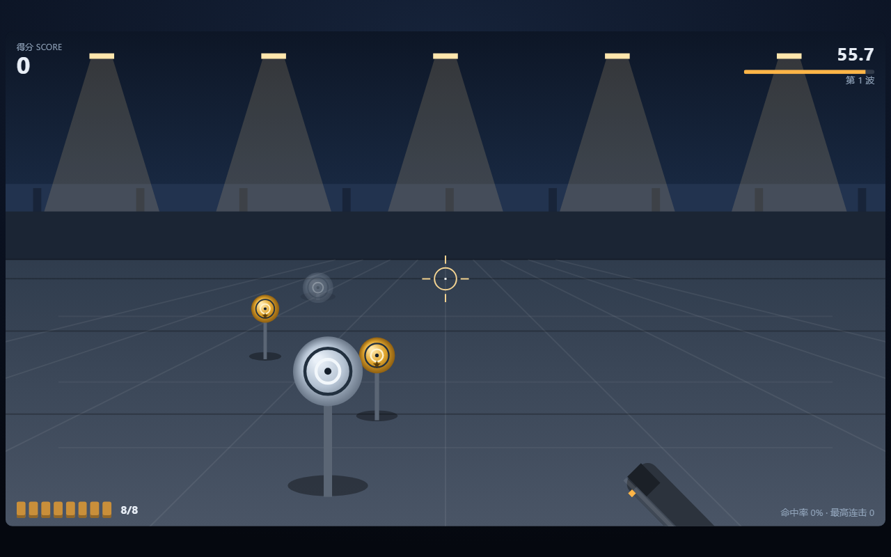

# 📄 Word 文件复制 · 源目录 → 目标目录

单文件网页 [`word-copy.html`](word-copy.html)：两个输入框（源目录 / 目标目录）+ 一个「文件复制」按钮，
点一下就把源目录里**所有子目录**中的 Word 文档（`.docx` / `.doc`）拷贝到目标目录。
零依赖、零构建，双击即可打开。

## 怎么用

**免授权用法**：双击仓库里的 `word-copy.bat` —— 它自动启动本机助手并打开页面，
两个默认目录已经填好，直接点 **文件复制** 就行，不需要授权任何文件夹。

| 步骤 | 说明 |
| --- | --- |
| 1 | 双击 `word-copy.bat`（或先跑助手、再打开 `word-copy.html`）。页面打开时两个框已按需求填好默认值：源目录 `D:\Programs Data\DeepTutor\data\user\workspaces`、目标目录 `E:\word` |
| 2 | 点 **文件复制** |
| 3 | 看结果表：每个文件从哪儿来、在目标目录里叫什么、是复制 / 覆盖 / 跳过 / 失败 |

助手没在跑的时候，页面不会只丢一句「请先授权文件夹」，而是直接给出三种免授权启动办法：
双击 `word-copy.bat`（提示里带出它的实际路径）、粘一条启动助手的 PowerShell 命令、
点「重新探测助手」。探测还会自动重试几次，避免助手刚起来时抢跑。

- **只复制 Word 文档**：`.rtf`、`.odt`、`.wps`、`.pdf`、`.txt`、图片等一律不动；Word 打开时产生的
  `~$` 临时锁文件和隐藏文件也自动排除。
- **递归查找，只复制文件**：源目录的所有子目录都会被找进去，但**不照搬源目录的结构**。
  默认按「生成日期」归档：在目标目录下建 `年-月-日` 文件夹，文件名前也带上年月日
  （`2026-08-15\2026-08-15_合同.docx`）。日期取文件的**创建时间**，取不到时用修改时间；
  取消勾选「按生成日期归档」就回到全平铺。同一天里的重名文件自动用上级目录名做前缀改名，互不覆盖。
- **文件没修改就不重复写入**：目标里已有同名且内容没再改过的文件直接跳过，也不碰它的写入时间。
  助手模式按「大小相同 + 修改时间相同」判定（`Copy-Item` 会保留源时间戳，所以能精确比对）；
  浏览器授权模式写入后目标时间会变成「刚才」，改用「大小相同 + 目标不比源旧」这种宽松判定，
  同样做到第二次点「文件复制」全是跳过、不重复写盘。取消「同名则覆盖」后同名文件一律跳过。
  归档模式下判重看的是「日期文件夹 + 带日期的最终文件名」，跨天的同名文件各归各的日期，互不影响。
- **点授权按钮直接打开默认目录**：已经授权过的目录会被记住（存在浏览器 IndexedDB 里），
  以后再点「授权源目录 / 授权目标目录」**直接打开默认目录** —— 输入框保留完整默认路径，不再弹选择器；
  记住的目录只是默认目录的上层时，会自动进到那一层；记的不是默认目录（名字接不上）时按老规矩跳回它本身。
  第一次点仍会弹系统选择器 —— 浏览器安全上不允许网页凭空按路径打开文件夹，必须亲手授权一次；
  页面会同时把默认目录和「双击 `word-copy.bat` 免授权直达」的做法标出来，**选完目录界面立刻更新，
  不等存储落定**（`file://` 双击打开时 Chromium 的 IndexedDB 可能永远不回调，老版本因此出现
  「点了授权按钮没反应」；现在所有存储调用都带 1.2 秒超时，卡住也只影响「下次记忆」，不影响本次使用）。
  记住的目录被移动或权限被收回时，自动退回系统选择器重选一次。想主动换目录就按住 <kbd>Shift</kbd> 再点按钮，
  或点记忆条上的「清除记忆」。
- 目标目录不存在时自动创建（助手模式）。

### 「E:\word 建不出日期文件夹」怎么排查

按生成日期归档要在目标目录里新建 `年-月-日` 文件夹，建不出来一般是这几种，
现在页面都会用中文点名是哪个文件夹、下一步做什么（不再抛一句英文 `Failed to create new folder` 就完事）：

| 提示里出现 | 原因 | 怎么办 |
| --- | --- | --- |
| 「同名位置已经是一个文件」 | 目标目录里有一个**文件**正好叫 `2026-11-13` 这样 | 把那个文件改名或挪走，再点「文件复制」 |
| 「请确认目标目录 … 可写」 | 目标目录只读、被占用，或权限不足 | 换一个可写目录，或给当前用户加上「创建文件夹」权限 |
| 「浏览器不允许…只给了只读权限」 | 用「授权目标目录」时只给了读取权限 | 重新点「授权目标目录」并在选择器里允许写入；或改用本机助手（双击 `word-copy.bat`） |
| 「本机助手是旧版本，没有按日期归档」 | 端口上跑着改动前启动的旧助手 | 关掉助手窗口，重新双击 `word-copy.bat`；期间可取消勾选「按生成日期归档」，仍能正常复制 |

> 旧版助手会**悄悄平铺**、看起来像「归档没生效」。现在助手在 `/api/status` 里自报
> `dateMode: true`，页面据此识别：旧助手会在探测时就说明，复制时也会直接报错，不会假装成功。

## 三种后端

浏览器出于安全不能直接读写任意本地文件夹，所以页面会自动选择后端，右上角状态条写明当前用的是哪一种：

| 后端 | 怎么开 | 能力 |
| --- | --- | --- |
| ① 本地助手（推荐，**免授权**） | 双击 `word-copy.bat`（自动起助手 + 打开页面），或 `powershell -ExecutionPolicy Bypass -File tools\word-copy-server.ps1` 后访问 `http://127.0.0.1:8765/` | 认输入框里的真实路径，递归 + 按生成日期归档（或平铺）；日期取真实创建时间；只监听 `127.0.0.1`，只做「列 Word 文件」和「复制文件」两件事，不删除任何东西，关窗口即停 |
| ② 浏览器授权 | 点「授权源目录 / 授权目标目录」亲手挑两个文件夹（Chrome / Edge 的 File System Access API） | 无需助手，但必须由用户授权，手打路径读不到 |
| ③ 生成复制命令 | 点「生成复制命令」，粘到 PowerShell 执行 | 兜底：同样递归、同样只拷 Word、同样平铺；区别是不同子目录里的同名文件会互相覆盖（一条命令没法改名），要保留两份请用助手或授权模式 |

## 代码结构

- `__CORE_START__ … __CORE_END__`：**规则内核**（Word 判定、递归清单、平铺改名、覆盖/跳过决策、计数、校验、命令生成），
  纯函数、不访问 DOM，可直接断言。
- `__UI_START__ … __UI_END__`：渲染与交互层（后端探测、助手 HTTP、目录授权、结果表、命令面板、页内自检）。

## 自动化参数

| 参数 | 作用 |
| --- | --- |
| `?src=` / `?dst=` | 覆盖默认源 / 目标目录 |
| `?helper=http://127.0.0.1:8765` | 指定助手地址（默认 8765，探测失败会自动重试几次） |
| `?autocopy=1` | 探测完成后自动执行一次（截图与全链路验证用） |
| `?preview=1` | 只预览不落盘 |
| `?overwrite=0` | 取消「同名则覆盖」 |
| `?dateMode=0` | 取消「按生成日期归档」，改回全平铺 |
| `?cmd=1` | 打开时直接展开生成的复制命令 |
| `?demoAuth=1` | 演示「已记住授权目录、点按钮直接打开默认目录」的界面状态（纯展示，不探测助手、不产生任何写入、也不算真实授权） |
| `?demoNotice=1` | 演示「从没授权过时点授权按钮」的说明态：写明默认目录 + 免授权一步做法 + 手动选择入口（纯展示，不弹选择框、不写入） |
| `?theme=dark` | 深色启动 |
| `?selftest=1` | 页底列出页内自检结果（当前 123 项） |

页内暴露 `window.wordcopy`（`state` / `core` / `setPaths()` / `run()` / `ping()` / `selftest()`）供检查。

## 验证

- `powershell -ExecutionPolicy Bypass -File tools\word-copy-check.ps1`：**81 项断言全部通过**
  （递归只取 `.docx`/`.doc`、排除 `~$` 与隐藏文件、平铺且目标不产生子目录、同名不同目录自动改名不覆盖、
  重复拷贝跳过且**不触碰目标时间戳**、内容有差才覆盖、不勾选覆盖时一律跳过、预览不落盘不建目录、目标缺失时自动创建、
  四类入参校验报错，以及助手 HTTP 的 `/api/status` / `/api/copy` / 400 错误通道；
  外加 `word-copy.bat` 免授权启动器的静态校验（纯 ASCII、带 `-Port`、助手已在跑时不重复启动、先绑端口再开浏览器）；
  外加**建日期文件夹失败说人话**一组：同名位置已是文件时指出「哪个文件夹、改名或删掉后重试」，
  目标目录不可写时说明「目标目录不可写」，并核对助手 `/api/status` 自报支持归档（页面据此识别旧版助手）；
  外加**按生成日期归档**一组：把夹具里两份文件的创建时间设成不同的过去日期（其中两份设成同一天），
  核对日期文件夹按创建时间生成、文件名前带年月日、同一天不同子目录的重名互不覆盖、只多日期这一层不照搬源结构、
  再跑一次全部跳过且不碰目标时间戳、预览不建日期目录、取消勾选时回到平铺且文件名不带日期前缀；
  浏览器授权模式那条路径也用假目录句柄真跑了一遍 `browserCopy`（写入、改名、建日期文件夹都在里面，纯函数测不出来）；
  最后用无头 Edge 跑页内自检与「浏览器 → 助手 → 磁盘」全链路，确认状态报完成且磁盘上确有 4 个文件、分别落在日期文件夹里且文件名都带日期前缀，`?dateMode=0` 再跑一遍时回到平铺 4 个、无子目录，
  并单独验证**免授权主路径**：直接 `file://` 双击页面时助手在线、用两个默认目录给出计划、授权按钮隐藏、
  不出现「请分别授权」，以及助手离线时页面给出免授权启动办法；
  另加**直接打开默认目录**两组：`?demoAuth=1` 核对输入框保留完整默认路径、状态条写明已直接打开两个默认目录、
  按钮提示与说明文案；`?demoNotice=1` 核对没授权过时的说明态给出默认目录、说明浏览器不能按路径直接打开、
  指向 `word-copy.bat` 一步免授权，并显示手动选择入口）。
- `word-copy.html?selftest=1`：**123 项页内断言全部通过**（含内核 18 个函数齐备、递归清单与平铺/归档改名规则、
  默认目录值、预览用词与实复制用词区分、免授权提示控件与 `word-copy.bat` 路径推导、控件齐备与文案；
  「不重复写入」的严格/宽松两种判定各 8 项；「点授权按钮直接打开默认目录」用假目录句柄串起 15 项异步断言 ——
  能按输入路径进到子目录、名字接不上时退回授权目录、记住的就是默认目录时不弹选择器且输入框保留完整默认路径、
  状态条写明已直接打开、记的不是默认目录时按老规矩跳回、没授权过时点按钮立刻弹选择器（点击必有反应）并同时
  说明默认目录与免授权做法、**把 IndexedDB 换成永不回调的假对象后选完目录界面照样更新**（「点了没反应」的回归防线）、
  Shift/记忆条主动换目录直接弹选择器、记住的目录不可用时给重选说明并等新手势（不在手势里硬弹会被浏览器拒）、
  点重选入口才弹选择器）。
- 助手 `tools\word-copy-server.ps1` 与检查脚本都是纯 PowerShell，不需要 Node、不需要安装任何东西。

## 截图

`docs/screenshots/` 下 `word-copy-before-*.png` 是改动前 `origin/main` 的实际内容（`main` 上已有
word-copy.html，改前基线直接取 `origin/main:word-copy.html`），`word-copy-after-*.png` 是本分支的运行画面：
默认目录与范围说明、深色配色、页内自检全绿、504×900 窄屏、助手在线的预览画面、真复制完成画面
（4 个文件平铺进目标目录，其中两个同名 `deep.docx` 自动改名）、取消覆盖时的跳过画面、生成的复制命令，
以及**免授权**两张：`word-copy-after-no-auth-defaults.png`（直接 `file://` 双击页面，助手在线、
两个默认目录已填好、不要求授权）与 `word-copy-after-helper-offline-hint.png`（助手离线时页面给出的
免授权启动办法：双击 `word-copy.bat` / 一条 PowerShell 命令 / 重新探测助手）。
「点授权按钮直接打开默认目录」的改前 / 改后对比是同一场景、同一视口下的两张：
`word-copy-before-default-open.png`（改前：输入框被写成「📁 已跳回：workspaces」，完整默认路径没了）
与 `word-copy-after-remember-jump.png`（改后：输入框保留完整默认路径，状态条写明已直接打开两个默认目录）；
`word-copy-after-default-notice.png` 是改后新增的「从没授权过时点授权按钮」说明态。
**按生成日期归档**的改前 / 改后同样是同一场景、同一视口、同一夹具（四份 Word 文件，其中两份创建时间刻意相同）：
`word-copy-before-date-mode.png`（改前：四个文件全平铺在目标目录，`2024年报/deep.docx` 与
`合同归档/deep.docx` 靠改名区分，看不出是哪天生成的）与 `word-copy-after-done.png`
（改后：分别落进 `2025-07-01` / `2026-07-16` / `2026-11-13` 三个日期文件夹，文件名前都带上年月日，
同一天那两个重名文件仍自动改名互不覆盖）；`word-copy-after-flat.png` 是取消勾选归档后回到平铺的对照画面；
`word-copy-after-folder-error.png` 是「建日期文件夹失败」的画面 —— 目标目录里放了一个与日期同名的文件时，
报错会点名是哪个文件夹并说明改名或删掉后重试，不再是英文一句 `Failed to create new folder`。
预览/真复制几张取的是仓库内的临时目录（`.verify/shots/src → dst`），不读写真实的 `E:\word`。
全部可用 `powershell -ExecutionPolicy Bypass -File tools\word-copy-shots.ps1` 复现。
窄屏截图取 504px：本机无头 Edge 会把 CSS 视口下限钳制到约 504px，因此未标注为 390px。

---
# 🚗 成语大飞车 · Idiom Drive

单文件网页 [`idiom-driving.html`](idiom-driving.html)：开着车在公路上接成语。Canvas 即时绘制，
纯离线、零依赖、零构建，双击即可打开。

## 怎么玩

公路迎面铺开，每个成语缺一个字，四条车道里三条挂着字牌、一条空着——**变道接住缺的那个字**。
接对了，完整成语连拼音和释义一起弹出，还会**用语音读给你听**；接错或放跑都扣一条命。

| 操作 | 按键 |
| --- | --- |
| 左右变道 | <kbd>←</kbd> <kbd>→</kbd> 或 <kbd>A</kbd> <kbd>D</kbd>，触屏可滑动，点击车道也可直达 |
| 暂停 / 继续 | <kbd>空格</kbd> 或 <kbd>P</kbd> |
| 重开一局 | <kbd>R</kbd> |
| 静音 / 朗读开关 / 深色 / 存图 | <kbd>M</kbd> · <kbd>V</kbd> · <kbd>T</kbd> · <kbd>E</kbd> |

- 题库 30 条成语，每条带拼音与释义；题序 `seed` 固定后出题完全可复现。
- **路很长**：前方取景 30 格（约 240 米），每块字牌都要开过一段路才到车头；路边有里程桩标出米数。
- **车是移送过去的**，不是瞬移：换一道要花约 0.6 秒滑过去，车身跟着侧倾；每道横向移送约 4.2 米，也计入里程。
- HUD 有实时里程表，画面下缘还有一条「字牌 → 车头」的进度条，看得出每块牌还有多远。
- 来牌速度随得分上升（每 600 分 +1 格/秒，最快 30 格/秒）。
- 「开车答题」自己开，「AI 演示」自动开给你看。

## 自动化参数

| 参数 | 作用 |
| --- | --- |
| `?seed=1..99999` | 指定题序，同一 seed 永远同一套题 |
| `?demo=1` | AI 演示 |
| `?auto=1` | 跳过菜单直接开打 |
| `?ff=6` | 载入后同步快进 6 秒（无头截图用，不依赖 rAF 推进） |
| `?theme=dark\|light` | 强制主题 |
| `?sound=off` / `?voice=off` | 关闭音效 / 关闭语音朗读 |
| `?freeze=1` / `?pause=1` | 载入即定格 / 暂停 |
| `?selftest=1` | 页底显示页内自检结果 |

页内暴露 `window.driving`（`state()` / `ff()` / `go()` / `setLane()` / `savePNG()`）供检查与截图。

## 验证

- `idiom-driving.html?selftest=1`：**25 项页内断言全部通过**（含题库格式、同题序出题一致、换题序出题改变、
  答案恰在一处、有一条空车道、前方取景距离够长、移送是连续的而非瞬移、里程表随行驶增加、
  接对得分、接错扣命、放跑扣命、命用完一局结束、暂停冻结时间、AI 演示能答对、速度随得分上升、
  弹层含拼音与释义、画布非空白的像素检查、可导出 PNG、无横向溢出）。
- `node tools/idiom-drive-core.cjs`：**83 条规则 / 状态机断言全部通过**（另覆盖移送耗时≈距离/移送速度、
  移送途中确实经过中间车道、三种结果计数之和等于出题数、16 组种子均不抛异常且状态无 NaN、多种子都能出题）。
- `node tools/idiom-drive-ui-harness.cjs`：DOM + Canvas 桩驱动 UI 层跑完整场景，渲染与输入事件全程不抛异常、
  HUD 无 NaN、弹层里确有四个汉字与拼音释义。
- 无头 Edge 截图见 `docs/screenshots/`：`before-idiom-drive-main.png` 是改动前 `main` 分支的实际内容
  （`main` 上没有开车游戏），`after-idiom-drive-*.png` 是本分支的运行画面（菜单、浅色/深色对战中带成语弹出、
  504×900 窄屏、页内自检全部绿），全部由无头 Edge 按固定题序抓取，可直接复现。

---

# 🐭 猫和老鼠迷宫大作战 · Cat &amp; Mouse Maze

单文件网页 [`cat-mouse-game.html`](cat-mouse-game.html)：在随机生成的迷宫里偷光所有奶酪，躲开追来的猫。Canvas 即时绘制，纯离线、零依赖、零构建，双击即可打开。

## 怎么玩

| 操作 | 按键 |
| --- | --- |
| 跑动老鼠 | 方向键 / <kbd>WASD</kbd>，触屏可滑动 |
| 暂停 / 继续 | <kbd>空格</kbd> 或 <kbd>P</kbd> |
| 重来一局 | <kbd>R</kbd> |
| 静音 / 深色 / 存图 | <kbd>M</kbd> · <kbd>T</kbd> · <kbd>E</kbd> |

- 收集地图里所有的 🧀 奶酪，拿一株 🌿 猫薄荷可让猫打盹变慢。
- 三档难度（轻松 / 正常 / 惊险），每次「重来」按迷宫编号重新生成随机迷宫。
- 支持单人对猫与 AI 表演赛两种模式。

## 自动化参数

| 参数 | 作用 |
| --- | --- |
| `?seed=1..99999` | 指定迷宫编号，同一 seed 永远同一张图 |
| `?ai=easy\|normal\|hard` | 指定难度 |
| `?demo=1` | AI 表演赛（自动对打，适合围观） |
| `?auto=1` | 跳过菜单直接开打 |
| `?theme=dark\|light` | 强制主题 |
| `?sound=off` | 关闭音效 |
| `?freeze=1` / `?pause=1` | 载入即定格 / 暂停（无头截图用） |
| `?selftest=1` | 页底显示页内自检结果 |

页内暴露 `window.catmouse`（`state()` / `go()` / `ff()` / `setDir()` / `savePNG()`）供检查与截图。

## 验证

- `cat-mouse-game.html?selftest=1`：**23 项页内断言全部通过**（含迷宫连通与墙体两侧对称、奶酪数量固定、同格即被扣一条命、猫薄荷 6 秒生效与过期、暂停冻结时间、集齐奶酪获胜、AI 老鼠能偷奶酪、画布非空白的像素检查、可导出 PNG、无横向溢出）。
- `node tools/cat-mouse-core.cjs`：33 条规则 / 迷宫 / 状态机断言全部通过（另覆盖无敌期不扣命、命用完即失败、12 组种子 × 三档难度均不崩溃且 AI 能持续得分）。
- `node tools/cat-mouse-ui-harness.cjs`：DOM + Canvas 桩驱动 UI 层跑完整场景，渲染与输入事件全程不抛异常、HUD 无 NaN。
- 无头 Edge 截图见 `docs/screenshots/`：`before-cat-mouse-main.png` 是改动前 `main` 分支的实际内容（`main` 上没有猫和老鼠页面），`after-cat-mouse-*.png` 是本分支的运行画面（菜单、浅色/深色对打中、504×900 窄屏、页内自检全部绿），全部由无头 Edge 按固定随机种子抓取，可直接复现。
# 🚂 英语小火车 · English Word Train

给小学一 ~ 四年级孩子的背单词小游戏：单文件网页 [`english-game.html`](english-game.html)，
纯离线、零依赖、零构建，双击即可打开。看图画、听发音，从四个单词里选出正确的那个 ——
答对了小火车就往前开一节，开到终点站就赢。

## 玩什么

- **先选年级**：打开就是「1. 选年级 · 2. 选词库」两步，一年级 / 二年级 / 三年级 / 四年级
  四颗按钮，换了年级，下面的词库、题数和难度都跟着变。
- **四个年级共 110 个词、19 个词库**（每年级 4–5 类 + 一个「本年级全部」混合）：

  | 年级 | 词数 | 词库 | 默认题数 |
  | --- | --- | --- | --- |
  | 一年级 Grade 1 | 27 | 动物 · 颜色 · 数字 · 身体 | 8 |
  | 二年级 Grade 2 | 23 | 食物 · 学习用品 · 自然 · 玩具·物品 | 8 |
  | 三年级 Grade 3 | 30 | 家人 · 职业 · 地点 · 形容词 · 穿戴·日常 | 10 |
  | 四年级 Grade 4 | 30 | 学科 · 时间 · 天气 · 动作 · 出行 | 10 |

- **难度随年级走**：看图选词的比例从一年级 70% 一路降到四年级 30%，中英互译和补全单词
  相应增加 —— 小小孩靠图认词，大孩子开始背拼写。干扰项永远只从**同一年级**里出，
  不会让一年级孩子看到四年级的词。
- **三四年级的抽象词不硬画图**：家人、职业、学科、形容词这类没有对应图标的词，
  题卡上画一张写着中文的卡片，并且自动只出「听中文选英文」或「补全单词」，
  绝不会问「这是什么」却给一张看不出所以然的图。
- **答错可以重来**：一题最多选四次，一次答对 100 分、两次 60、三次 30，
  选满四次仍没对就自动揭晓正确答案、本题 0 分，孩子不会被卡住。
- **答对就朗读**：浏览器自带的语音合成读出这个单词和例句（Chrome / Edge 效果最好），
  没答对之前「听一听」只念题面、不会把答案念出来；没有语音环境时自动退化为响铃提示，
  游戏照常可玩。
- **即时反馈**：画面上飘 `Great! 太棒了！`、卡片弹出星星粒子、火车轮子和烟真的在动，
  连对时火车跑得更快；结算按平均分给 0–3 颗星，**每个年级每个词库各记一份最佳成绩**。

## 怎么玩

| 操作 | 按键 |
| --- | --- |
| 选择答案 | 鼠标 / 触屏点，或 <kbd>1</kbd>–<kbd>4</kbd>、<kbd>A</kbd>–<kbd>D</kbd> |
| 听一听 | <kbd>空格</kbd> 或 `🔊 听一听` |
| 下一题 | <kbd>Enter</kbd> / <kbd>→</kbd> 或 `下一题` 按钮 |
| 重新开始 | <kbd>R</kbd> |
| 音效 / 深色 | <kbd>M</kbd> · <kbd>T</kbd> |

没答对时「下一题」不会生效，孩子必须把这道题做出来才能往前走 —— 这是刻意的：
游戏的目标是记住这个词，而不是把十题点完。

## 画面里有什么

一帧画面全部由 Canvas 现场绘制，没有任何图片素材：渐变天空与日/月、四朵飘动的云、
两道山脊与一行远景树、山脚隧道、里程标、枕木与铁轨、终点站小屋与飘动的旗子、
三节车厢的小火车（车轮会转、烟囱会冒烟、跑起来会颠），以及插在木牌上的题卡。
54 个单词图标（猫、熊猫、猪、鸭子、猴子、苹果、蛋糕、铅笔、书包、尺子、课桌、雨伞、
帽子、外套、鞋子、公交车、自行车、火车、风筝、小船、飞机、雨、云、风、雪…）
都是一笔一笔代码画出来的路径与渐变。音效用 WebAudio 现场合成，无音频文件。

## 代码结构

- `__CORE_START__ … __CORE_END__`：**规则内核**（年级表、词库、出题、选项、计分、星级、
  火车速度、最佳成绩合并），只用标准数学、不访问 DOM，可以在 Node 里直接跑单元测试。
- `__UI_START__ … __UI_END__`：渲染与交互层（场景绘制、图标绘制、年级/词库选择、
  题面 DOM、语音、音效、自检）。

## 自动化参数

| 参数 | 作用 |
| --- | --- |
| `?grade=1..4` | 指定年级（默认一年级） |
| `?unit=animals\|food\|family\|travel4\|mixed…` | 指定词库；只给词库不给年级时按该词库所属年级选年级 |
| `?rounds=8` | 题数（4–20，不给则按年级默认 8/10） |
| `?seed=123` | 固定出题序列，便于复现 |
| `?mode=pic\|cn\|spell` | 强制某一种出题方式（抽象词强制 `pic` 会自动降级） |
| `?word=apple` | 把某个词固定为第一题（不在该词库里则不改动序列） |
| `?auto=1` | 跳过选年级直接开局 |
| `?solve=3&miss=1` | 无人值守连答 3 题（`miss` 让前几题先答错一次再看对） |
| `?selftest=1` | 页底列出 37 项自检结果 |
| `?theme=dark` / `?sound=off` / `?motion=off` | 深色 / 静音 / 静止 |
| `?freeze=4.2` | 定格到指定动画时刻（无头截图用） |
| `?ui=canvas` | 隐藏界面外壳，只留满幅画面 |

页内暴露 `window.ewt`（`state()` / `start({grade,unit,rounds,seed,mode,word})` / `pick()` /
`solve()` / `next()` / `api`）供检查与截图。

## 验证

```
node tools/english-game-core.cjs   # 内核：年级表、词库、出题、计分、状态机
node tools/english-game-ui.cjs     # 用 DOM + Canvas 桩驱动 UI 层打完一整局
```

- `english-game-core.cjs`：**237 项断言全部通过**。覆盖 110 词 × 4 年级 × 19 词库的字段
  完整性（含例句必须包含该词、中文例句必须是汉字、专名大小写白名单）、每个年级的
  词库都 ≥ 4 词且**跨年级绝不串词**（指定年级时结果永远只含该年级的词，本年级没有这个
  词库就回退本年级全部）、干扰项优先同词库→同年级补齐、四个年级 × 全部词库 × 全库每词
  都能凑出 4 个不选项、出题比例按年级递减且四个年级实际跑批都真的出现看图题、
  抽象词强制 `pic` 一律降级、连续两题不重复、`scoreFor` 非法入参不越界不 NaN、
  星级阈值、火车速度上限、同种子序列完全一致、`?word=` 固定第一题且不重复、
  四个选项全错的自动揭晓、结束后不再改分、最佳成绩按「年级:词库」只保留更高分，
  以及 **88 局随机对局**（4 年级 × 全部词库 × 4 种子）全部正常收束、年级不串、总分合法。
- `english-game-ui.cjs`：真的把页面里的 `<script>` 取出来，在桩 DOM 里跑 2400 帧，
  点年级按钮换年级、打完一整局、走一遍答错重来、4 个年级 × 12 种子共 48 局，
  再逐个触发选项按钮、朗读、主题、音效与全部键盘按键：确认全程不抛异常、每帧确有绘制、
  HUD 与题面不含 `NaN`/`undefined`、年级名与「年级:词库」的最佳成绩确实写进
  `localStorage`、页内自检 37 项全绿，并且「听一听」在答对之前不会把答案念出来。
  默认参数、纯菜单路径、三年级、四年级出行词库、只给 `?unit=` 五种配置都跑过。
- `english-game.html?selftest=1`：37 项页内断言全部通过（含像素级检查：画布非空白、
  每个图标都能画且不抛异常、图标与单词双向无孤儿、窄屏无横向溢出、控件齐备、
  年级按钮切换后词库跟着变）。

## 截图

`docs/screenshots/` 下 `english-before-main-index.png` 是改动前 `origin/main` 的实际内容
（`main` 上没有任何学英语的游戏页面，`git cat-file -e origin/main:english-game.html`
报 *exists on disk, but not in 'origin/main'*），`english-after-*.png` 是本分支的运行画面：
选年级 + 选词库的入口、三种出题方式、答对反馈、结算、三年级抽象词题卡、四年级出行词、
深色主题、页内自检全绿、纯画面、504×900 窄屏。全部由无头 Edge 按上表参数抓取，
`node tools/english-game-shots.cjs` 可直接复现。
窄屏截图取 504px：本机无头 Edge 会把 CSS 视口下限钳制到约 504px，因此未标注为 390px。

---

# 🐉 画一条龙 · Chinese Dragon

单文件网页 [`dragon.html`](dragon.html)：一条程序化绘制的中国神龙，Canvas 即时作画，
纯离线、零依赖、零构建，双击即可打开。

## 画了什么

脊线是一条行进的正弦蛇形曲线；沿法向按「头粗尾细」的宽度函数生成管状龙身，逐段铺叠鳞甲、
金线腹脊与火焰状鬃毛。龙头带鹿角、立眉、长须、獠牙与下龙髯，四爪踏云，吻前悬一颗火珠；
背景是夜云或宣纸，全在一块 Canvas 上即时绘制，没有任何图片素材。

换一个新种子就换一条龙：身形波浪、盘绕幅度、体色与鬃毛、须长角形、四爪位置都随之改变。

## 怎么玩

| 操作 | 按键 |
| --- | --- |
| 暂停 / 继续 | <kbd>空格</kbd> |
| 再画一条（换种子） | <kbd>R</kbd> |
| 夜云 / 宣纸 | <kbd>T</kbd> |
| 导出 PNG | <kbd>E</kbd> |
| 游动速度 | 拖动滑块，0 为静止 |

页面内置自检：打开 `dragon.html?selftest=1` 会校验同种子同姿态的画面校验和一致、换种子画面
确实改变、画布非空白、控件与 API 齐备、HUD 已填充，并把逐项结果列在页面底部。

## 自动化参数

| 参数 | 作用 |
| --- | --- |
| `?seed=123` | 固定龙形，便于复现 |
| `?freeze=2.2` | 定格到指定动画时刻 |
| `?speed=1.5` | 初始游动速度 |
| `?theme=light` | 宣纸配色 |
| `?auto=0` | 打开即暂停 |
| `?selftest=1` | 页面内自检 |

## 截图

`docs/screenshots/` 下 `before-dragon-main.png` 是本次改动前 `main` 的实际内容
（仓库当时还没有任何龙的页面），`after-dragon-*` 是本次的运行画面：夜云与宣纸两套配色、
另一个种子的龙形、以及页面内自检全绿，全部由无头 Edge 按上表参数抓取，可直接复现。

---
# 🐦 小鸟飞上天 · Little Bird Flies Up

一本可以翻页、会动的中英双语小绘本（5 页）：单文件 HTML + Canvas，纯离线、零依赖、零构建。
双击打开 [`bird-story.html`](bird-story.html) 即可阅读。

## 故事

蓝翅膀小鸟清晨从树窝里探出头，第一次认真看天。它张开翅膀飞过草地，掠过像镜子一样的水潭
（水里还有另一只小鸟），越飞越高，看见一行行稻田、浅水里的白鹭和排成“人”字往南飞的大雁；
天黑以后飞回窝里闭上眼睛 —— 明天还要再飞高一点。

文字、拼音、汉字学习点与每页的 Banana Nano 绘画提示词在 [`content/bird-story.md`](content/bird-story.md)
（按 picture-book-wizard 绘本魔法师模板生成，含跨页角色一致性锚点与事实性核对）。

## 怎么玩

| 操作 | 按键 |
| --- | --- |
| 上一页 / 下一页 | <kbd>←</kbd> <kbd>→</kbd>，或画面左上角 ‹ › 与右上角圆点 |
| 自动翻页 | <kbd>空格</kbd> 或 `▶ 自动翻页`（底部进度条走完自动翻，末页自动停） |
| 跳到某页 | <kbd>1</kbd>–<kbd>5</kbd> |
| 回到第 1 页 | <kbd>R</kbd> |
| 语言 | 双语 / 中文 / English 三档切换 |
| 静音 / 深色 | <kbd>M</kbd> · <kbd>T</kbd> |

第一页（清晨页）还带一首四行的**日出小诗**《日出小诗 / A Sunrise Poem》：天边泛粉、橘光漫开、
太阳露出半边脸、小鸟接住第一缕暖，中英对照并附拼音；翻到别的页面时这首诗自动收起。

每页画面都是 Canvas 现场绘制：同一只蓝翅膀小鸟（蓝背白腹、深色眼纹、橙色喙，跨页外观一致），
五页分别是清晨大树与窝、草地低飞、水潭倒影、高空稻田与雁阵、星空回家。音效用 WebAudio 现场合成，无音频文件。

## 自动化参数

| 参数 | 作用 |
| --- | --- |
| `?page=1..5` | 直接打开某一页 |
| `?selftest=1` | 页面底部显示 20 项自检结果（文本齐备、拼音带声调、学习汉字出现在正文、翻页边界、自动翻页计数、每页可绘制、无横向溢出等） |
| `?auto=1` | 载入即开始自动翻页 |
| `?rate=2.2` | 自动翻页每页秒数 |
| `?lang=zh\|en` | 单语显示 |
| `?theme=dark` / `?sound=off` | 深色启动 / 静音 |
| `?freeze=1&t=3.4` | 定格到指定动画时刻（无头截图用） |
| `?ff=12` | 同步快进 12 秒（无头环境 rAF 不推进时验证自动翻页） |

页内暴露 `window.book`（`state()` / `go()` / `ff()` / `pose()`）供检查与截图。

## 验证

- `bird-story.html?selftest=1`：20 项页内断言全部通过（无头 Edge 抓取 DOM 核对，含「无横向溢出」）。
- 无头 Edge 实测 `?auto=1&ff=12` 会走到第 4 页、`ff=100` 停在第 5 页，自动翻页与边界行为真实生效。
- 五个页面 + 深色 + 窄屏（504×900）截图见 `docs/screenshots/`：
  `before-bird-story-baseline.png` 是改动前 `main` 上的实际内容（仓库里没有任何小鸟故事页面），
  `after-bird-p1..p5-*.png` 是本分支的运行画面。窄屏截图取 504px：本机无头 Edge 会把 CSS 视口
  下限钳制到约 504px，因此未标注为 390px。

---

# dome-sa

这是一个 dsh-superagent 演示仓库
This line was added to verify the agent flow.

明天会更好
## 地月自传

`index.html` 是一个可直接双击打开的单文件页面：《地月自传 · 四十五亿年，由我们俩轮流讲给你听》。

- **两个第一人称声音**：十二个时代里，地球与月球各讲一段，月球只说得到月球才说得着的事。
- **可播放的自传**：点「播放讲述」按时间轴自动推进，可 1× / 2× 变速，也可拖动滑块或点任何一幕直接跳转。
- **日心宇宙场景**：Canvas 实时绘制——太阳居中，地球绕太阳公转，月球绕地球公转；星云盘、岩浆海、海洋、冰盖、生命色斑、夜面灯火与红巨星随时代演变；月球在星云时代尚未诞生，诞生后按真实比例逐渐退行。
- **实时数据**：月球距离、地球一日长度、距今年代随时代插值变化。
- **两种配色**：夜空 / 晨昏；桌面与手机都可用。
- 键盘：`←` `→` 切换时代，`空格` 播放/暂停，`Home` 回到星云，`End` 跳至未来。

文案来源见 `content/story.md`（含数据契约与时代清单）。页面内置自检：打开 `index.html?selftest=1` 会校验十二个时代、双声部文案、播放控件与窄屏溢出，并在页面底部输出结果。
# 小兔和乌龟赛跑 🐢🐰

伊索寓言《龟兔赛跑》的单文件 HTML 互动动画。

## 怎么玩

用浏览器直接打开 `index.html` 即可，无需安装任何东西，也没有网络依赖和构建步骤。

- **空格** 或 `▶ 开始比赛`：开始 / 暂停
- **R**：重置比赛
- **W** 或 `🥕 叫醒兔子`：兔子睡着时把它叫醒
- **1 / 2 / 4**：1× / 2× / 4× 倍速
- **速度曲线**：在画面左上角叠加双方已跑距离
- **自动重赛**：一局结束后自动再来一局
- **🌙 深色**：切换深色 / 浅色主题

## 规则

| | 特点 |
| --- | --- |
| 🐢 乌龟 | 恒定速度，全程一步不停 |
| 🐰 小兔 | 速度快但带节奏起伏；沿途 4 根胡萝卜，经过必停下来啃一口（约 1 秒），啃完约有六成概率当场睡着 4–9 秒 |

谁先到达 100m 终点线谁赢。因为打瞌睡是随机的，每局胜负都可能不同：兔子并非必输，但只要它多睡一觉，不停步的乌龟就有机会 —— 这正是这则寓言最有意思的地方。

## 技术说明

- 单个 HTML 文件，Canvas 2D 手绘角色与场景（兔子、乌龟、云朵、山丘、树木、观众小动物、终点彩带）
- 时间步进式物理更新，与渲染帧率解耦，倍速只改变时间步长
- 无任何外部库、字体、图片或 CDN 请求，可完全离线运行
- 响应式布局，窄屏下画面自动缩放
- 支持 `?theme=dark`（深色启动）、`?auto=1`（自动开始）等查询参数，便于自动化截图
# dome-sa

## 靶场射击 · 打枪小游戏

单文件网页射击游戏：[`shooting-game.html`](shooting-game.html)，双击即可离线运行，无需构建、无依赖。

- **玩法**：60 秒限时打靶。钢靶命中 100 分（靶心 1.5 倍），金色★奖励靶 220 分，蓝色人形罚靶误伤扣 150 分并清空连击。
- **连击**：连续命中每 3 发提升 0.5 倍倍率，最高 ×5；结算按得分给出 S–E 评级，历史最佳记录在本地。
- **操作**：鼠标移动瞄准、左键开火（触屏直接点击），`R` 换弹（弹匣 8 发，打空自动换弹），`P` / `Esc` 暂停，`Enter` 开始或再来一局。
- **反馈**：枪口火光、后坐力、屏幕震动、命中火花与飘分、弹孔残留，音效用 WebAudio 实时合成，无音频文件。

可选 URL 参数（调试与截图用，正常游玩不需要）：`?duration=30` 改时长、`?seed=123` 固定靶位随机序列、`?autostart=1` 跳过菜单、`?demo=auto` 自动瞄准观战、`?selftest=1` 在页面内跑 21 项逻辑自检、`?steps=N&every=M&shoot=K` 以固定帧步进取决状态。


# 🏓 乒乓球

一个可以直接双击打开的乒乓球游戏：单文件 HTML + Canvas，纯离线运行，零依赖、零构建。

## 怎么玩

用浏览器打开 `index.html` 即可（也支持手机浏览器）。

| 操作 | 按键 |
| --- | --- |
| 移动球拍 | 鼠标 / 触摸拖动，或 <kbd>←</kbd> <kbd>→</kbd> |
| 发球 | <kbd>空格</kbd> 按住蓄力、松开（蓄力越满球速越快、落点越深） |
| 扣杀 | 对打中按一次 <kbd>空格</kbd> |
| 双人模式（上方蓝拍） | <kbd>A</kbd> <kbd>D</kbd> 移动，<kbd>Shift</kbd> 蓄力发球 |
| 暂停 / 重置 / 静音 / 深色 | <kbd>P</kbd> 或 <kbd>Esc</kbd> · <kbd>R</kbd> · <kbd>M</kbd> · <kbd>T</kbd> |

三种模式：**单人对电脑**、**双人对战**（同键盘）、**AI 表演赛**（自动对打，适合围观）；
三档难度；赛制可选一局 11 分、三局两胜、五局三胜。

## 规则（按真实乒乓球规则实现）

- **11 分制，净胜 2 分**；10:10 之后进入平分，每球交换发球权，此前每 2 球交换一次。
- **发球必须两段落台**：先落本方台面，弹起过网后再落对方台面。直接落对方台面、
  没落本方台面、或弹起后没过网，都判失分。
- **擦网好球判 LET**：发球擦网后仍落入对方有效区域时不计分，重新发球。
- **回球必须等球在本方台面弹起后**才能击打，未弹起就拦击属于抢击犯规。
- **两跳得分**：球在对方台面弹两下对方没接到，算本方得分。
- **下网 / 出界**：球被球网挡回、或落在台面之外，判对方得分。
- 球台 `2.74m × 1.525m`、网高 `0.1525m`，均为国际乒联真实尺寸。

## 画面之外还有什么

- 球有真实的抛物线、台面弹跳（含弹性衰减）、侧旋（挥拍横向速度会带出弧线）。
- 击球点离拍心越远越难控制：边缘碰球容易出界或下网。
- 计分板实时显示当前比分、局分、本回合板数、最长回合与最快球速。
- 深色 / 浅色主题跟随系统，可手动切换；窄屏下画面与控件自适应。
- 音效用 WebAudio 现场合成（击球、弹台、下网、得分），无音频文件。

## 自动化参数

便于演示与截图，页面支持若干查询参数：

| 参数 | 作用 |
| --- | --- |
| `?auto=1` | 跳过准备页直接开打 |
| `?demo=1` | 强制 AI 表演赛（配合 `auto` 可无人值守对打） |
| `?mode=single\|two\|demo` | 指定模式 |
| `?ai=easy\|normal\|hard` | 指定难度 |
| `?seed=123` | 固定随机种子，便于复现某一局 |
| `?theme=dark\|light` | 强制主题 |
| `?sound=off` | 关闭音效 |
| `?bo=3` / `?target=21` / `?winby=2` | 自定义赛制 |
| `?ff=26` | 载入后同步快进 26 秒（用于无头截图，不依赖 rAF 推进） |
| `?freeze=1` / `?pause=1` | 快进后定格 / 暂停 |
| `?charge=0.72` | 直接摆出发球蓄力状态 |

## 代码结构

整个游戏在一个 `index.html` 里，分成两块：

- `__CORE_START__ … __CORE_END__`：**规则与物理内核**，只用标准数学、不访问 DOM，
  因此可以抽出来在 Node 里直接跑单元测试。对外暴露 `createGame(cfg)`。
- `__UI_START__ … __UI_END__`：渲染与交互层，把内核状态投影成伪 3D 画面
  （近大远小的透视梯形台面 + 高度偏移），并处理键鼠触摸、音效、HUD。

物理采用固定子步长（1/300 s）积分，与渲染帧率解耦；弹道求解是给定落点反推初速度，
并自动加弧直到能过网——所以 AI 不需要「碰运气」也能打出合法且贴网的球。

## 验证

内核与 UI 都有可重复运行的无头检查（需要 Node，游戏本身不需要）：

```
node tools/extract.cjs        # 从 index.html 抽出内核与整段脚本
node tools/check-syntax.cjs   # 语法检查
node tools/harness.cjs        # 44 项规则 / 物理 / 状态机断言
node tools/ui-harness.cjs     # 用 DOM + Canvas 桩驱动 UI 层跑完整场比赛
```

`harness.cjs` 覆盖：发球轮换（含 10:10 平分）、发球两段落台与 LET 抢击、11 分净胜 2 分、
多局比赛的局分与先发交换、暂停与重置、球不穿台面、数值不溢出、
14 组种子 × 三档难度均无卡死且胜负均衡。

`ui-harness.cjs` 则真的把页面里的 `<script>` 取出来，在 Node 里用桩 DOM 跑 1 万帧以上，
确认渲染与输入事件全程不抛异常、HUD 不出现 `NaN`。

## 截图

`docs/screenshots/` 下是改动的对比证据：`before-*` 是改动前 `main` 分支的实际内容
（仓库根目录只有一个 1 行的 `README.md`，没有任何可玩页面），
`after-*` 是本分支的运行画面（浅色对打、深色对打、发球蓄力、终局、390×844 窄屏）。
全部由无头 Edge 按固定随机种子抓取，可用上表参数复现。

# 📈 sin(x) 曲线 · 互动绘图仪

`sin-curve.html`：一个可直接双击打开的单文件曲线页面，用滑块实时改变正弦曲线的形状，
并把「单位圆里那条旋转的半径」和「曲线上同步扫描的点」画在一起。零依赖、零构建、纯离线运行。

## 能做什么

- **一条真曲线**：`y = A·sin(Bx + C) + D`，四个参数各一个滑块，公式、周期、值域随参数实时改写。
- **五组预设**：`sin x` / `cos x` / `sin 2x` / `½·sin(x/2)` / `sin x + 0.5`；一改参数，虚线仍显示基准 `y = sin x` 作对照。
- **单位圆联动**：点「▶ 扫描」，曲线上的红点与圆里那条半径一起转，圆上的竖直分量正是 `sin θ` —— 一眼看出正弦值从哪来。
- **鼠标取点**：指针在画面上移动即取该处的点，读出弧度、`π` 的倍数、函数值与角度。
- **自动标注**：零点画小圆点，极值用橙色圈并标出数值；x 轴刻度在 `π/12 … 2π` 间按画面宽度自动选密度，窄屏也不会糊成一排。
- **两种配色**：深色 / 浅色，跟随系统也可手动切换；显示范围与扫描速度可调。
- 键盘：`空格` 扫描/暂停 · `←` `→` 步进取点（`Shift` 加大步长）· `↑` `↓` 调振幅 · `[` `]` 缩放 · `R` 复位 · `T` 主题。

## 自动化参数

调试与截图用，正常打开不需要：

| 参数 | 作用 |
| --- | --- |
| `?theme=dark\|light` | 强制主题 |
| `?A=1.8&B=2&C=0&D=0.5` | 直接设定四个参数 |
| `?cycles=N` | 显示范围 ±N·π/2（1 – 12） |
| `?probe=1.05` | 把取点固定在这个 x |
| `?auto=1` | 载入即开始扫描 |
| `?speed=1.6` | 扫描速度 |
| `?freeze=1` | 只画一帧，用于定格截图 |
| `?selftest=1` | 在页面底部跑 16 项自检 |

## 验证

页面分成两块：`__CORE_START__ … __CORE_END__` 之间是纯数学内核（坐标变换、等距采样、
零点与极值求解、刻度密度、π 分数格式化），只用标准数学、不访问 DOM；
`__UI_START__ … __UI_END__` 是渲染与交互层。两块都有能在 Node 里直接跑的无头检查（页面本身不需要 Node）：

```
node tools/sin-curve-core.cjs     # 90 项数学断言
node tools/sin-curve-harness.cjs  # DOM + Canvas 桩驱动 UI 层跑 7200 帧
```

`sin-curve-core.cjs` 覆盖：`sin` 在 0 / π/2 / π / −π/2 的取值、2π 周期性、π/2 对称性、
`A/B/C/D` 组合与 `B=3` 时周期缩到 2π/3、相位 π/2 即 `cos`、屏幕坐标往返一致、
原点落在绘图区内且 x 向右 / y 向上的方向正确、采样覆盖整个范围且逐点满足方程、
零点与极值的个数和位置（含 `D≠0` 时零点标在 `y=D`、`B=0` 时不除零）、
刻度间距不低于像素下限且窄屏自动退回 2π、`π/2`、`2π/3`、`−2π`、`6π` 这类分数格式化与约分、
角度归一化、单位圆恒等式、扫描点永不越界且扫完一圈回到左端点。

`sin-curve-harness.cjs` 真的把页面里的 `<script>` 取出来，在桩 DOM 里跑 7200 帧，
再逐个触发滑块、复选框、预设按钮、指针移动/按下/离开与全部键盘按键：
确认全程不抛异常、每帧确有绘制调用、复位回到 `y = sin x`、极端参数（A=2.4 B=4 cycles=12）下渲染仍不产生非法坐标、
面板文本不含 `NaN` / `undefined`。

页面内置自检：打开 `sin-curve.html?selftest=1` 会校验采样有限性、零点与极值计数、坐标往返、
窄屏不溢出与控件状态同步，并把逐项结果列在页面底部。

## 截图

`docs/screenshots/` 下 `sin-curve-before-*` 是本分支之前的 `main` 实际内容，
`sin-curve-after-*` 是本分支的运行画面（浅色桌面、深色扫描、改参数后的虚线对照、
大范围缩放、页面内自检、520×900 窄屏），全部由无头 Edge 按上表参数抓取，可直接复现。
（无头 Edge 的视口宽度下限约 504px，所以窄屏截图取 520×900；单列布局在 504px 处已由页面内
「窄屏不溢出」一项校验。）
---

# 🐦 枝头小鸟 · A Picture of a Bird

一幅**包含小鸟的图画**：单文件 HTML + Canvas，纯离线、零依赖、零构建，画面里没有任何图片素材
（天空、太阳/月亮、云、远山、树线、草地、水潭、树干、树枝、叶片、花瓣和那只蓝翅膀小鸟，
全部是代码现场绘制的路径与渐变）。双击打开 [`bird-drawing.html`](bird-drawing.html) 即可看到。

## 画里有什么

清晨的旷野：左边一棵大树伸出一根向右下弯垂的长枝，一只蓝背白腹、橙色尖喙、头顶三撮小冠羽的
小鸟停在枝上，歪着头看左边的太阳；枝上长着带叶柄的嫩叶，远处是两道山脊与一行针叶林，
草地上有一汪会起涟漪的水潭，空气里飘着花瓣。

## 怎么玩

| 操作 | 按键 |
| --- | --- |
| 换时段（清晨 / 正午 / 黄昏 / 星夜） | <kbd>1</kbd>–<kbd>4</kbd>，或顶部按钮 |
| 重画一张新构图 | <kbd>R</kbd> 或 `🎲 重画` |
| 指定构图 | 在 `构图` 输入框填 seed（1–99999），同一 seed 永远同一张画 |
| 动 / 静 | <kbd>M</kbd> 或 `🕊 动起来`（鸟会呼吸点头、偶尔眨眼、尾羽轻摆、云与花瓣飘动） |
| 深浅色界面 | <kbd>T</kbd> |
| 导出 PNG | <kbd>S</kbd> 或 `💾 保存 PNG`（导出纯画布，不含界面） |

四个时段是四套完整调色板（34 个颜色键 × 4）：清晨暖阳、正午高日、黄昏落日把鸟压成剪影、
星夜有弯月与闪烁星空。

## 自动化参数

| 参数 | 作用 |
| --- | --- |
| `?preset=dawn\|noon\|dusk\|night` | 指定时段 |
| `?seed=7` | 指定构图（默认 7） |
| `?selftest=1` | 页内跑 19 项断言并列出结果（含像素级检查） |
| `?freeze=1&t=4.2` | 定格到指定动画时刻（无头截图用，画面完全可复现） |
| `?ui=off` | 隐藏标题与按钮，只留满幅画布 |
| `?theme=dark` / `?motion=off` / `?sig=0` | 深色启动 / 关闭动画 / 去掉右下角签名 |

页内暴露 `window.drawing`（`state()` / `go(t)` / `ff(sec)` / `setPreset()` / `setSeed()` /
`toDataURL()` / `bird()` / `branchY(x)`）供检查与截图。

## 验证

- `bird-drawing.html?selftest=1`：**19 项页内断言全部通过**。除控件与文案外，还包括直接读
  `getImageData` 的像素检查——鸟身区域 ≥50% 不是天空色、头/喙/尾三块区域都有内容、
  眼内有高光、爪子精确落在树枝中心线上、窄屏无横向溢出、同 seed 同刻重绘哈希一致、
  换 seed 构图改变、导出的 PNG 非空。
- 无头 Edge 实测四个时段 + 深浅色界面 + 窄屏（504×900）截图见 `docs/screenshots/`：
  `before-baseline-main-index.png` 是改动前 `main` 上的实际首页（本分支基线 `575c1a1`，
  其 `index.html` 与 `392405b` 相同），而 `bird-drawing.html` 在 `main` 上并不存在
  （`git cat-file -e origin/main:bird-drawing.html` 报 *exists on disk, but not in 'origin/main'*），
  `after-bird-drawing-*.png` 是本分支的运行画面。窄屏取 504px：本机无头 Edge 会把 CSS 视口
  下限钳制到约 504px，因此未标注为 390px。


---

# 🐯 林中之虎 · A Picture of a Tiger

一幅完全由 Canvas 现场绘制的孟加拉虎插画：单文件 HTML（[`tiger-drawing.html`](tiger-drawing.html)），
零依赖、零图片、零构建，双击即可离线打开。

画面分四层：渐变天空与日/月、三层远山、左右两侧的竹林与竹叶、前景草丛；虎由躯干、四肢、尾巴、
头、颈、耳等 10 条路径拼成轮廓，肚皮与口鼻的白色、49 道条纹、耳背的黑白斑都只落在轮廓之内
（离屏图层 + `source-atop`），最后统一罩一层时段光色与暗角。

| 时段 | 画面 |
| --- | --- |
| 晨雾 Dawn | 低垂的暖日、斜射光柱、贴地晨雾 |
| 正午 Noon | 高色温蓝天、竹林清晰、影子最短 |
| 黄昏 Dusk | 落日压山、琥珀色罩层、眼睛开始反光 |
| 星夜 Night | 星空与月亮、萤火、虎眼的照膜反光（夜视是人的六倍） |

四种姿态（巡视 / 低吼 / 回首 / 潜行）会改变头颈、尾巴幅度与身体高度；移动鼠标时瞳孔跟着你看，
点一下画面它会眨眼。`保存 PNG` 直接把当前画面导出为图片。

## 自动化参数

| 参数 | 作用 |
| --- | --- |
| `?time=dawn\|noon\|dusk\|night` | 指定时段（或 <kbd>1</kbd>–<kbd>4</kbd>） |
| `?pose=0..3` | 指定姿态（或 <kbd>P</kbd> 循环） |
| `?theme=dark` | 深色页面外壳（或 <kbd>T</kbd>） |
| `?freeze=1&t=3.4` | 定格到指定动画时刻，供无头截图 |
| `?selftest=1` | 页底显示 20 项自检结果 |

页内暴露 `window.tiger`（`state()` / `set()` / `render()` / `savePNG()` / `runSelftest()`）。

## 验证

- `tiger-drawing.html?selftest=1`：20 项页内断言全部通过（含四个时段渲染无异常、四个姿态可循环、
  条纹数 ≥ 40、可导出 PNG、无横向溢出）。
- 无头 Edge 截图见 `docs/screenshots/`：`tiger-before-main-landing.png` 是改动前 `main` 上的实际内容
  （仓库里没有任何虎的画面），`tiger-after-dawn|noon|dusk|night.png` 与
  `tiger-after-dark.png`、`tiger-after-narrow-504x900.png`、`tiger-after-pose-*.png` 是本分支的运行画面。
  窄屏截图取 504px：本机无头 Edge 会把 CSS 视口下限钳制到约 504px，因此未标注为 390px。

---

# 🌧 巴山夜雨 · A Picture of a Poem

一幅为李商隐《夜雨寄北》配的画：单文件 HTML + Canvas，
零依赖、零图片、零构建，双击打开 [`poem-drawing.html`](poem-drawing.html) 即可看到。

> 君问归期未有期，巴山夜雨涨秋池。
> 何当共剪西窗烛，却话巴山夜雨时。

## 画里有什么

画面按诗的顺序铺开：夜云与弯月下，三重山脊由远到近层层叠起，
脊线上长着成行的针叶林，山脚浮一道贴地的雾——这就是"巴山"；
雨丝分近远两层斜斜落下，近雨走在山前、远雨走在山后，给出纵深感；
画面下方是一片涨了水的秋池，椭圆水面上有天光、山影、涟漪与细碎反光；
右上方是一扇木格西窗，窗内点着一支烛，烛焰会晃、光晕会呼吸——
"何当共剪西窗烛"就落在这扇窗上。左下竖排题写四句诗与"巴山夜雨 · 唐 · 李商隐"，
题字带一层暗影，四个时段里都读得清。

全部元素都是代码现场绘制的路径与渐变，没有使用任何图片素材。

## 怎么玩

| 操作 | 按键 |
| --- | --- |
| 换时段（雨暮 / 夜雨 / 雨歇 / 阴午） | <kbd>1</kbd>–<kbd>4</kbd>，或顶部按钮 |
| 重画一张新构图 | <kbd>R</kbd> 或 `🎲 重画` |
| 指定构图 | 在 `构图` 输入框填 seed（1–99999），同一 seed 永远同一张画 |
| 动 / 静 | <kbd>M</kbd> 或 `🌧 动起来`（雨落、烛焰晃、云飘、涟漪扩散、草叶摇） |
| 深浅色界面 | <kbd>T</kbd> |
| 导出 PNG | <kbd>S</kbd> 或 `💾 保存 PNG`（导出纯画布，不含界面） |

四个时段是四套调色板（37 个颜色键 × 4）：雨暮的紫红天光、夜雨的深蓝与月光、
雨歇的灰蓝天光配低日、阴午的阴沉云色。夜雨与雨暮有月/星，雨歇与阴午没有。

## 自动化参数

| 参数 | 作用 |
| --- | --- |
| `?preset=dusk\|night\|dawn\|noon` | 指定时段 |
| `?seed=7` | 指定构图（默认 7） |
| `?selftest=1` | 页内跑 18 项断言并列出结果（含像素级检查） |
| `?freeze=1&t=4.2` | 定格到指定动画时刻（无头截图用，画面完全可复现） |
| `?ui=off` | 隐藏标题与按钮，只留满幅画布 |
| `?theme=dark` / `?motion=off` / `?sig=0` | 深色启动 / 关闭动画 / 去掉题款 |

页内暴露 `window.drawing`（`state()` / `go(t)` / `ff(sec)` / `setPreset()` / `setSeed()` /
`toDataURL()` / `ridgeAt()` / `palette()` / `keys()`）供检查与截图。

## 验证

- `poem-drawing.html?selftest=1`：**18 项页内断言全部通过**。除控件与文案外，还包括直接读
  `getImageData` 的像素检查——天空确实是上/中/下三段渐变、整幅着色颜色种类 ≥ 8（画面不是空白）、
  秋池池心颜色明显区别于天空色、西窗内确有 4800+ 个暖色像素（烛光真的亮着）、
  `ridgeAt` 采样出的山脊高差 > 20px、同 seed 同刻重绘哈希一致、换 seed 构图改变、
  两个时刻雨区哈希不同（雨真的在下）、导出的 PNG 非空。
- 这一版修掉的问题：早期脚本把 `skyMid:#E0F7FA` 这类**不带引号的十六进制**写进对象字面量，
  JS 会把它读成私有字段 `#E0F7FA`，整个脚本抛 `SyntaxError`，画布因此一片空白
  （页面外壳与按钮正常，只有 canvas 全黑）。现在所有颜色都是带引号的字符串，
  并把「所有颜色都是规范字符串」单独做成了自检项，防止这种写法回潮。
- 无头 Edge 截图见 `docs/screenshots/`：`poem-before-broken-blank.png` 是修复前那一版的运行画面
  （`main` 上原本没有这个页面，所以这份"改动前"证据取自本分支修复前的破版文件，
  抓到的是用户看到的那张全黑画布），`poem-after-art-*.png` 是修复后的纯画布画面
  （夜雨 / 雨暮 / 雨歇 / 阴午 / 另一 seed），`poem-after-night.png` 等带界面外壳，
  另有深色外壳、504×900 窄屏与页内自检全绿。全部由无头 Edge 按上表参数抓取，可直接复现。
  窄屏截图取 504px：本机无头 Edge 会把 CSS 视口下限钳制到约 504px，因此未标注为 390px。

---

# 🎯🐦 猎人与鸟 · Hunter and Bird

一个包含三种玩法的单文件网页游戏：[`hunter-bird-game.html`](hunter-bird-game.html)，
双击即可离线运行，无需构建、无依赖。

## 三种玩法

- **猎人模式**：60 秒限时打飞鸟。麻雀 100 分、野鸭 150 分、锦鸡 300 分，连击每 3 只提升
  0.5 倍倍率（最高 ×5）。蓝色「护」标的**保护鸟类**（丹顶鹤）打中扣 200 分并清空连击；
  枪声会惊起附近的鸟，它们随即加速并爬升，越打越难瞄。
- **小鸟模式**：这回你当小鸟。躲开猎人从地面打来的弹丸，采集浆果（红色 50 分、金色 150 分），
  三根羽毛用完或时间到就结算。猎人开火前会用红色虚线瞄你，看到线就赶紧挪窝。
- **单词模式 Grade 1 – 4**：一次只显示**一个英语单词**，带中文意思和一张现场画的图片，
  单词会**读出声**（Web Speech API 朗读，另配 WebAudio 提示音）；听完发音才能开枪，
  而且**一个单词只有一颗子弹** —— 打中背图片的那只小鸟就 +100 分并进入下一个单词，
  打偏或让鸟飞走，同一个单词会带着图片飞回来重来。四个等级依次解锁：
  - **Grade 1**（10 词）：sun / cat / fish / tree / star / egg / hat / cup / bird / cow
  - **Grade 2**（10 词）：apple / rabbit / flower / rocket / panda / pencil / banana / tiger / cloud / house
  - **Grade 3**（10 词）：butterfly / clock / umbrella / dragonfly / volcano / ladder / rain / book / snake / turtle
  - **Grade 4**（10 词）：kite / candle / magnet / bell / compass / fountain / dragon / island / castle / planet

  打完一个等级自动进入下一个；也可以随时按 <kbd>G</kbd> 在四个等级之间切换，或用
  `?grade=1..4` 直接从某个等级开始。

## 操作

| 操作 | 按键 |
| --- | --- |
| 瞄准 / 操控飞行 | 鼠标移动，或触屏拖动 |
| 开火（猎人模式 · 单词模式） | 左键 / <kbd>空格</kbd> |
| 飞行（小鸟模式） | <kbd>←</kbd> <kbd>→</kbd> <kbd>↑</kbd> <kbd>↓</kbd> / <kbd>WASD</kbd> |
| 再听一遍发音（单词模式） | <kbd>S</kbd> |
| 切换 Grade 1 / 2 / 3 / 4（单词模式） | <kbd>G</kbd> |
| 换弹（弹匣 6 发） | <kbd>R</kbd> |
| 暂停 | <kbd>P</kbd> / <kbd>Esc</kbd> |
| 开始 / 再来一局 | <kbd>Enter</kbd> |
| 切换模式 | <kbd>H</kbd> / <kbd>B</kbd> / <kbd>W</kbd> |
| 静音 · 深色 / 浅色 | <kbd>M</kbd> · <kbd>T</kbd> |

## 画面

全部由 Canvas 现场绘制：四套时段配色（黎明 / 正午 / 黄昏 / 星夜）、云与星空、两道山脊、
针叶林线、草地，以及路径画出的猎人与四种鸟（扇翅、被惊起、中弹坠落、羽毛四散）。
单词模式的 40 张单词图片也都是代码画的（太阳、猫、鱼、树、星星、鸡蛋、帽子、杯子、小鸟、奶牛；
苹果、兔子、花、火箭、熊猫、铅笔、香蕉、老虎、云、房子；蝴蝶、时钟、雨伞、蜻蜓、火山、梯子、雨、
书、蛇、乌龟；风筝、蜡烛、磁铁、铃铛、指南针、喷泉、龙、岛、城堡、行星），同样没有图片素材。
音效用 WebAudio 现场合成，发音用浏览器自带的语音合成，没有音频文件。

## 自动化参数

| 参数 | 作用 |
| --- | --- |
| `?mode=hunter\|bird\|word` | 直接进入某一玩法 |
| `?grade=1\|2\|3\|4` | 单词模式从哪个等级开始 |
| `?time=dawn\|noon\|dusk\|night` | 四套时段配色 |
| `?theme=light` | 浅色页面外壳 |
| `?seed=5` | 固定随机种子，便于复现 |
| `?auto=1` | AI 代打：猎人自动瞄准、小鸟自动躲弹、单词模式等发音完自动开枪 |
| `?steps=N` | 无 rAF 固定帧步进 N 帧后定格渲染（无头截图用） |
| `?devstats=1` | 右下角显示本帧状态 JSON |
| `?duration=30` | 改单局时长 |
| `?selftest=1` | 页内 59 项自检，结果显示在页面底部 |

## 验证

- `hunter-bird-game.html?selftest=1`：**59/59 断言通过**（随机种子与权重、命中判定、
  保护鸟扣分、连击倍率、换弹流程、枪声惊鸟、提前量、弹丸命中与无敌帧、采果、边界钳制、
  猎人齐射、两种结束条件、主题切换、无横向溢出、画布非空白、开发 API 齐备；单词模式另有
  四个等级词表齐备、等级间不重词、每个词都有图片、图片既不抛异常又**真的画出像素**、
  发音调用安全、听发音期间锁扳机、一个单词一颗子弹、命中记分并进入下一个单词、打偏重复
  同一个单词、等级按 1→2→3→4 依次解锁、打完 Grade 4 结算、每个等级都能单独开始）。
- 无头 Edge 按上表参数抓取的画面见 `docs/screenshots/`：`before-hunter-main-landing.png`
  是改动前 `origin/main`（`13cdb13`）的实际内容 —— 仓库里没有这个页面
  （`git cat-file -e origin/main:hunter-bird-game.html` 报 *not in 'origin/main'*）；
  `before-hunterbird-wordmode-menu.png` 是单词模式加入前那一版（`70cc4b3`）的菜单；
  `after-hunterbird-*` 是本分支的运行画面：三种玩法、黄昏与星夜、结算页、浅色外壳、
  单词模式的 Grade 1 / Grade 2 / Grade 3 / Grade 4 / 命中瞬间、窄屏 504×900、菜单与页内自检。
  窄屏截图取 504px：本机无头 Edge 会把 CSS 视口下限钳制到约 504px，因此未标注为 390px。

---

# 🎲 随机计算 · Random Math

一个随机出题的口算练习页：[`random-math.html`](random-math.html)，中文界面，双击即可离线运行，
零依赖、无构建、不联网（没有任何 CDN、字体或图片请求）。

## 玩什么

- **四个年级难度**（一年级 – 四年级）：一年级做 20 以内加减法；二年级做 100 以内加减与乘法口诀；
  三年级加入乘除与两位数加减；四年级是四则混合与括号。任何难度都不出现负结果，除法一定整除、
  除数不为 0。
- **两种玩法**：默认**固定题数**（一 / 二年级各 10 题，三 / 四年级各 12 题），也可以选
  **限时挑战**（一 / 二年级 60 秒、三年级 75 秒、四年级 90 秒），时间到或答完题数就结算。
- **即时判分**：提交后立刻给出反馈（答对 `✔ 答对了 +N`；答错 `✘ 正确答案是 N`）；
  答对加分（连击越高、答得越快分越高），答错不得分并清空连击。HUD 实时显示得分 / 连击 /
  进度或剩余时间 / 正确率，下面还有一条计时条。
- **结算与记录**：结算页给出得分、正确率、最佳成绩、平均每题耗时、答对 / 答错、最长连击
  与 0–3 星（正确率 ≥90% 三星、≥70% 两星、≥40% 一星）；刷新纪录时显示 `🎉 新纪录！`。
  最佳成绩按「难度 + 玩法」分别记在本机 localStorage 里，菜单上就能看到当前难度 / 玩法的最佳分。

## 操作

| 操作 | 方式 |
| --- | --- |
| 选难度 / 玩法 | 菜单里点 `一年级`–`四年级`、`固定题数` / `限时挑战`，或按 <kbd>1</kbd>–<kbd>4</kbd> 选难度 |
| 开始 | `开始计算 ▶`，或 <kbd>Enter</kbd> |
| 输入答案 | 点屏幕数字键盘，或直接用键盘打数字（输入框只收数字与 `-`，最多 6 位） |
| 提交 / 下一题 | 屏幕 `✓`，或 <kbd>Enter</kbd> |
| 退格 | 屏幕 `⌫`，或 <kbd>Backspace</kbd> |
| 重开一局 | 结算页 / 游玩中按 <kbd>R</kbd>，或结算页 `再来一局` |
| 回菜单 | 游玩中按 <kbd>Esc</kbd>，或结算页 `换难度` |
| 深浅色 · 音效 | 右上角 `🌙/☀️` · `🔊/🔇`，或按 <kbd>T</kbd> · <kbd>M</kbd> |

数字键盘以外的快捷键（<kbd>R</kbd> <kbd>T</kbd> <kbd>M</kbd> 与菜单里的 <kbd>1</kbd>–<kbd>4</kbd>）
在答案输入框没有聚焦时生效，这样正在打数字时按键不会被抢走。

## 自动化参数

| 参数 | 作用 |
| --- | --- |
| `?level=1..4` | 起始难度 |
| `?mode=time\|count` | 限时 / 固定题数 |
| `?count=N` | 固定题数模式的题数（4–50） |
| `?seed=N` | 固定出题序列（同 seed 永远同一套题） |
| `?auto=1` | 跳过菜单直接开局 |
| `?solve=N` | 无人值守连答对 N 题（每题按模拟作答耗时推进，最后一题的反馈不自动推进） |
| `?miss=K` | 前 K 题故意答错（配合 `solve`） |
| `?theme=dark\|light` | 强制深浅色主题 |
| `?sound=off` | 关音效 |
| `?ff=SEC` | 载入后同步快进 SEC 秒（不依赖 rAF） |
| `?freeze=1` | 快进后定格，停掉计时与动画（无头截图用） |
| `?selftest=1` | 页底列出页内自检结果 |

自动化顺序是固定的：先按 `level/mode/count/seed` 开局 → 无人值守作答 `solve + miss` 题
（每题之间模拟真实作答耗时，**最后一次的反馈不自动推进**）→ `ff` 同步快进 → `freeze` 定格。
所以 `?auto=1&level=2&solve=1&freeze=1` 停在答对反馈，`?auto=1&level=2&miss=1&freeze=1`
停在答错反馈，`?auto=1&level=3&mode=count&count=8&solve=8&ff=4&freeze=1` 直接停在结算页。

页内暴露 `window.randommath`（`state()` / `start(cfg)` / `submit(v)` / `ff(sec)` / `selftest()` /
`core` / `api`）供检查与自动化。

## 验证

- `random-math.html?selftest=1`：**页内自检 46 项全部通过**，覆盖各难度各 seed 的题目合法性、
  同 seed 复现与不同 seed 不同、除法整除、计分与星级单调、输入归一化与判定、状态机
  （答对加分、答错清连击、题数/时间到结束、结算数值有限）、控件齐备、窄屏无横向溢出、
  无外部请求。
- 无头 Edge 截图见 `docs/screenshots/`：`before-random-math-main-index.png` 是改动前
  `origin/main` 的真实首页 —— 那时没有这张卡片（`random-math.html` 在 `origin/main` 上不存在，
  截图脚本会断言这一点）；`after-random-math-index-nav.png` 是加卡片后的本分支首页，
  两张同视口（1280×1000）同主题，可直接对比。`after-random-math-menu.png`、
  `after-random-math-play-time.png`（限时挑战答题中）、`after-random-math-correct.png`（答对反馈）、
  `after-random-math-wrong.png`（答错反馈）、`after-random-math-result.png`（结算：星级与最佳成绩）、
  `after-random-math-dark.png`（深色主题）、`after-random-math-narrow-504x900.png`（504×900 窄屏）、
  `after-random-math-selftest.png`（页内自检全绿）是本页的运行画面，全部由
  `tools/random-math-shots.ps1` 按上表参数复现（本机没有 Node，所以是 PowerShell + 无头 Edge）。
  窄屏截图取 504px：本机无头 Edge 会把 CSS 视口下限钳制到约 504px，因此未标注为 390px。

